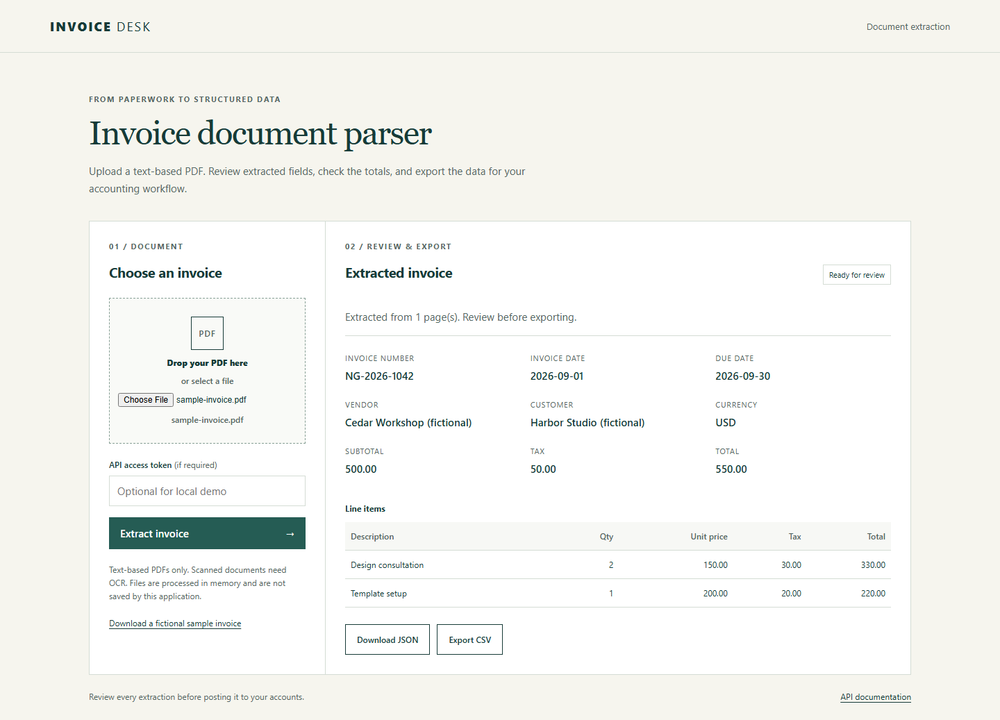

# Invoice Document Parser

Turn PDF invoices into structured JSON and CSV without manual data entry.

For bookkeepers and operations teams receiving recurring supplier invoices, this application extracts invoice fields, checks arithmetic, and flags missing information before export. Open the browser demo, upload the fictional sample, and download normalized data. No API key or paid service is needed for the local demo. Its extraction rules and exports can be adapted to a business's supplier formats and accounting workflow.

## Features

- Responsive PDF upload interface with drag and drop, review, warnings, JSON download, and CSV export.
- Invoice number, dates, vendor, customer, currency, subtotal, tax, total, and line items.
- Decimal financial values serialized as strings to preserve precision.
- Missing-field, arithmetic, and due-date checks.
- Deterministic local parsing or optional OpenAI structured extraction.
- Clear errors for encrypted, malformed, oversized, and likely scanned PDFs.

## Demo

Actual browser capture after uploading the fictional sample invoice:

[Mobile view](docs/images/invoice-mobile.png). This capture uses the deterministic demo provider.

## Quick start

Requires Python 3.12 or newer. From this repository:

~~~sh
python -m venv .venv
# macOS / Linux
source .venv/bin/activate
# Windows PowerShell: .venv\Scripts\Activate.ps1
python -m pip install -e ".[dev]"
python -m uvicorn app.main:app --host 127.0.0.1 --port 8001 --no-access-log
~~~

Open http://127.0.0.1:8001 and select [examples/sample-invoice.pdf](examples/sample-invoice.pdf). The default provider is demo; no environment file is required. Interactive API documentation is at /docs.

If PowerShell blocks activation scripts, run `.venv\Scripts\python.exe -m pip` and `.venv\Scripts\python.exe -m uvicorn` directly without activation.

## Docker

Requires Docker Engine and Compose v2:

~~~sh
docker compose config --quiet
docker compose up --build -d
curl http://127.0.0.1:8001/health
docker compose logs parser
docker compose down
~~~

The service binds to localhost. The container runs as a non-root user with a read-only filesystem, bounded temporary filesystem, dropped capabilities, and resource limits. No database or persistent uploads are used.

## Architecture

~~~mermaid
flowchart LR
    UI[Browser or API client] --> Limit[Request size and token checks]
    Limit --> PDF[PDF validation and text extraction]
    PDF --> Provider[Demo parser or OpenAI provider]
    Provider --> Validation[Schema and financial checks]
    Validation --> JSON[Normalized JSON and warnings]
    JSON --> CSV[CSV export]
~~~

FastAPI handles HTTP and validation; pypdf reads text; Pydantic defines the invoice contract. Providers share a small extraction boundary. The demo parser is format-aware and does not claim universal AI extraction. The service is stateless, so no database is necessary.

## API

| Endpoint | Purpose |
| --- | --- |
| GET /health | Configuration health; 503 for invalid provider configuration |
| POST /api/extract | Multipart PDF upload; invoice, warnings, provider, page count |
| POST /api/export/csv | Invoice JSON to CSV |

~~~sh
curl --fail -F "file=@examples/sample-invoice.pdf" http://127.0.0.1:8001/api/extract
curl --fail -H "Content-Type: application/json" --data @examples/sample-invoice.json http://127.0.0.1:8001/api/export/csv -o invoice.csv
~~~

If API_TOKEN is configured, add an Authorization: Bearer header or enter the token in the web interface. Health and static assets remain public. Error responses contain error.code and error.message. Status codes include 401 (auth), 413 (size), 422 (document/validation), 429 (rate), 408 (PDF timeout), and 502 (provider failure).

## Supported PDFs and extraction pipeline

**Text-based PDF:** text can usually be extracted directly. Demo parsing supports English labels, ISO dates (YYYY-MM-DD), uppercase three-letter currencies, nonnegative decimal amounts, and pipe-delimited item rows. See the fictional sample. Thousands separators such as 1,234.56 are accepted; ambiguous formats such as 1.234,56 are left missing for review.

**Scanned PDF:** image pages require OCR. OCR is not implemented. Pages without extractable text, including mixed scanned/text documents, return ocr_required. This conservative check may reject legitimate blank pages; remove them or pre-process the PDF.

The pipeline validates the signature and PDF reader, checks encryption and page limits, extracts bounded text, runs the selected provider, and validates schema and arithmetic. Missing fields remain null. Line totals include line tax. Currency compatibility with accounting systems requires additional business rules.

## Validation, JSON export, and CSV export

Warnings cover missing business and line-item fields, subtotal plus tax, line arithmetic, summed line totals, and due-date order. Unknown line tax stays unknown and prevents a misleading arithmetic assertion. Arithmetic uses a two-cent tolerance. Warnings do not prevent exports; a person should approve data before accounting entry. Negative invoices and credit notes are unsupported.

The browser JSON download includes invoice and extraction metadata. API clients can store the response directly. CSV contains one row per line item with repeated invoice identity, due date, subtotal, invoice tax, and invoice total; invoices without items export one summary row. Untrusted text beginning with spreadsheet formula markers gets an apostrophe prefix. CSV is a transport format, not an accounting vendor's import template.

## Configuration and optional AI extraction

Copy .env.example to .env for overrides; .env is ignored by Git. Process environment variables are also supported. Never publish credentials.

| Variable | Default | Purpose |
| --- | --- | --- |
| PROVIDER | demo | demo or openai |
| OPENAI_API_KEY | empty | Required only for OpenAI |
| OPENAI_MODEL | gpt-4o-mini | Model supporting structured outputs |
| API_TOKEN | empty | Optional locally; required for shared deployments |
| MAX_UPLOAD_MB | 8 | File byte limit; multipart body gets 64 KB overhead |
| MAX_PDF_PAGES | 30 | Maximum pages |
| MAX_TEXT_CHARS | 60000 | Extracted text limit |
| EXTRACTION_TIMEOUT_SECONDS | 20 | PDF processing response timeout |
| REQUESTS_PER_MINUTE | 20 | Per-IP, per-worker request budget |

Set PROVIDER=openai and OPENAI_API_KEY and restart to enable real AI extraction. The adapter calls OpenAI chat completions with a JSON schema and validates the response. Network calls have a 30-second timeout and no automatic retry. Tests use an HTTP mock, never a paid API. Live compatibility requires your account and chosen model.

Only OpenAI mode sends extracted document text externally. Assess contractual terms, retention, data location, and lawful processing before enabling it. Document content is untrusted; the provider has no tools or accounting write permissions. All model output still requires review.

## Adding OCR

Add a preprocessing adapter using sandboxed Tesseract or an approved OCR service. Preserve byte/page/time budgets, expose OCR confidence and provenance, and test fictional scanned fixtures. Do not silently assume all pages were read. OCR is an extension point, not an included feature.

## Accounting integrations

- **QuickBooks:** map vendor IDs, accounts, tax codes, and currency to the Accounting API. Use OAuth and reviewed draft transactions.
- **Xero:** map contacts, invoice lines, account codes, and taxes; obtain OAuth authorization and verify in a sandbox.
- **Google Sheets:** map normalized fields to a spreadsheet using an approved server identity or OAuth, preserving decimal precision.
- **Custom ERP:** implement an adapter, add idempotency keyed to vendor and invoice number, and submit approved results.

These are documented integration points, not implemented connectors. No accounting credentials are bundled.

API documentation pages load Swagger/ReDoc assets from jsDelivr and permit their inline bootstrap. The application UI remains restricted to same-origin assets. For a private deployment, restrict documentation routes or vendor these assets.

## Security and production considerations

- ASGI request limits run before multipart parsing, including chunked bodies; uploaded files have an independent byte limit. Export bodies are capped at 1 MB. Match these limits at your reverse proxy.
- Original filenames are never used as paths. Uploads are closed after handling. No files are saved by application code; multipart parsing may spool temporarily inside the runtime temporary directory. Docker bounds that filesystem.
- Uploaded PDF content is not executed. The reader has page, decompressed content-stream, and text limits. Decompression occurs before the stream check; hostile compressed PDFs need process/container memory limits.
- Two PDF worker slots bound concurrency. Timeout/cancellation retains the slot until the worker exits. Python threads cannot be forcibly stopped; use isolated subprocess workers with hard limits for hostile public uploads.
- Require a long random API_TOKEN, TLS, proxy body limits, upstream rate limiting, and deployment-appropriate authentication. The localhost demo defaults to no token. No permissive CORS is configured.
- The per-process in-memory limiter resets on restart. Multiple workers need shared rate limiting and trusted-proxy client identification. Arbitrary forwarded-IP headers are not trusted.
- Add production virus scanning/quarantine, patched dependencies, monitoring, and request timeouts before public uploads. Documented startup disables access logs to reduce query-string disclosure.
- Application event logs record event type, provider, page count, and warning count, never document text, filenames, tokens, or provider response bodies.
- This is an extraction utility, not accounting or tax advice. Privacy policy, retention rules, and incident response belong to the deploying business.

## Testing

~~~sh
python -m pytest
python -m ruff check .
python -m ruff format --check .
python examples/generate_invoice.py
~~~

Tests cover exact amounts, actual PDF uploads, line items, missing fields, impossible dates, arithmetic, scanned/encrypted PDFs, limits, auth, CSV injection, health/UI serving, and mocked provider success/failure. The sample PDF and text source are fictional and were created specifically for this repository. The CI workflow is configured to run lint, formatting, tests, Compose validation, image build, and HTTP container smoke requests; it has not run on hosted GitHub infrastructure yet.

Local QA passed 19 tests, Ruff and formatting checks, API startup and health, Swagger UI, wheel build and packaged startup, and desktop/mobile Chromium UI checks with axe accessibility checks. `docker compose config --quiet` passed using Compose CLI v5.5.1. Docker Engine was unavailable, so images were not built and containers were not started. Provider contracts were tested with mocks; no live LLM calls or external accounting accounts were used.

## Limitations

Demo parsing covers the documented format, not arbitrary layouts. No OCR, storage/history, user accounts, accounting write integrations, multi-currency arithmetic, negative credit notes, or automatic approval are included. Warnings are heuristic checks, not proof of accuracy. Public hostile PDF ingestion needs stronger process isolation. Model quality depends on the provider and document layout.

## Customization / Freelance

Need something similar for your business?

I build custom AI automation, backend systems, API integrations, and workflow automation.

I can customize extraction rules, document formats, accounting integrations, exports, and validation logic.

Email: [work@bububi.icu](mailto:work@bububi.icu)  
Telegram: [@o3amfeels](https://t.me/o3amfeels)  
GitHub: [@shipap](https://github.com/shipap)

Built by Alexander — AI Automation & Backend Developer.
